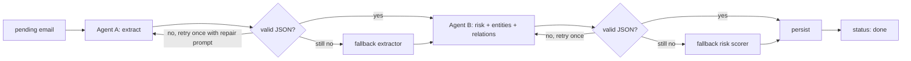

# Mail Risk Intelligence: Development Guide

This guide covers everything needed to run, develop and test **Mail Risk Intelligence**, a containerised full-stack app. It ingests emails and runs two chained LLM agents (extraction, then risk and graph analysis), orchestrated with LangGraph. It stores the results in SQLite and presents them in a React UI.

---

## 1. Prerequisites

### 1.1 Required to run the demo (reviewers)

The only thing needed to run the app is Docker. Everything else runs inside containers.

| Dependency | Version | Purpose |
|---|---|---|
| Git | 2.40+ | Clone the repository |
| Docker Engine (or Docker Desktop) | 24+ | Runs all services |
| Docker Compose v2 | 2.20+ | `docker compose up` orchestration (bundled with Docker Desktop) |
| A free Groq API key | n/a | Default LLM provider. Free tier, no card required: https://console.groq.com/keys |

**No paid API key is required.** The runtime supports three no-cost modes, picked automatically:

1. **Groq free tier** (default): set `GROQ_API_KEY` in `.env`.
2. **Ollama** (fully local and offline): run with `--profile local`. No key needed, but the first run downloads the model (about 2 to 5 GB, depending on the model).
3. **Rule-based fallback** (always available): if no LLM is reachable, a deterministic regex and keyword extractor and risk scorer produces results, flagged in the UI as `fallback`. The app never breaks because of the model.

Optional hardware for Ollama mode: 8 GB+ of free RAM (16 GB recommended). A GPU is optional.

### 1.2 Required for local development (outside Docker)

| Dependency | Version | Purpose |
|---|---|---|
| Python | 3.12 | Backend (FastAPI, LangGraph, worker) |
| uv (or pip + venv) | latest | Python dependency management |
| Node.js | 20 LTS+ | Frontend build and dev server |
| pnpm (or npm) | 9+ | Frontend package manager |
| SQLite CLI | 3.40+ | Optional: inspect the database |
| Ollama | latest | Optional: local models during development |
| Make | any | Optional: shortcut commands |

### 1.3 Main libraries (installed automatically)

**Backend (`backend/pyproject.toml`)**
- `fastapi`, `uvicorn[standard]`: HTTP API
- `pydantic` v2, `pydantic-settings`: schemas and env config
- `langgraph`, `langgraph-checkpoint-sqlite`: agent orchestration with resumable runs
- `langchain-core`, `langchain-groq`, `langchain-ollama`, `langchain-google-genai`, `langchain-openai`: provider adapters behind one interface
- `sqlalchemy` 2.x (or `sqlmodel`): storage layer on SQLite in WAL mode
- `python-multipart`: file uploads
- `pypdf`: PDF text extraction
- Python's built-in `email` package: `.eml` parsing
- `tenacity`: retries with backoff for LLM calls
- `structlog`: structured logs
- Dev: `pytest`, `pytest-asyncio`, `httpx`, `ruff`, `mypy`

**Frontend (`frontend/package.json`)**
- `react`, `react-dom`, `typescript`, `vite`
- `@tanstack/react-query`: data fetching, polling of processing status
- `react-router-dom`: inbox and detail routes
- `zod`: runtime validation of API responses
- `react-force-graph-2d` (or `cytoscape`): interactive knowledge graph
- Styling: Tailwind CSS (justify the choice in README)
- Dev: `vitest`, `@testing-library/react`, `eslint`, `prettier`

---

## 2. Quick start (demo mode)

```bash
git clone <repo-url> mail-risk-intel
cd mail-risk-intel
cp .env.example .env          # paste your free GROQ_API_KEY
docker compose up --build
```

Open http://localhost:8080. The 10 seed emails from `mock_mailbox_data.json` are ingested and processed on the first start.

Fully offline (Ollama, no key):

```bash
docker compose --profile local up --build
# first run pulls the model defined in OLLAMA_MODEL
```

No key and no Ollama: the app still starts and uses the rule-based fallback.

---

## 3. Architecture

```
mail-risk-intel/
├── docker-compose.yml
├── docker-compose.dev.yml        # dev overrides: hot reload, bind mounts
├── .env.example
├── Makefile
├── README.md
├── PROCESS.md                    # AI tooling workflow (graded)
├── MailRiskIntel-development.md  # this file
├── data/
│   └── mock_mailbox_data.json
├── backend/
│   ├── Dockerfile
│   ├── pyproject.toml
│   ├── app/
│   │   ├── main.py               # FastAPI app factory
│   │   ├── config.py             # pydantic-settings: env, provider selection
│   │   ├── api/                  # routers: emails, entities, graph, health
│   │   ├── ingestion/            # raw text, .txt, .pdf, .eml parsers → RawEmail
│   │   ├── agents/
│   │   │   ├── extraction.py     # Agent A: prompt + ExtractionResult schema
│   │   │   ├── risk_graph.py     # Agent B: prompt + RiskGraphResult schema
│   │   │   └── fallback.py       # rule-based extractor and risk scorer
│   │   ├── llm/
│   │   │   └── provider.py       # get_llm(): groq | gemini | ollama | openai | anthropic
│   │   ├── orchestration/
│   │   │   └── graph.py          # LangGraph: extract → validate → assess → validate → persist
│   │   ├── storage/              # SQLAlchemy models + repositories
│   │   └── worker.py             # polls pending emails, runs the graph
│   └── tests/
└── frontend/
    ├── Dockerfile                # multi-stage: node build → nginx
    ├── nginx.conf                # serves SPA, proxies /api → api:8000
    └── src/
```

### Services (`docker-compose.yml`)

| Service | Image | Role |
|---|---|---|
| `web` | `frontend/Dockerfile` | nginx serving the built React app on :8080, proxying `/api` to `api` |
| `api` | `backend/Dockerfile` | FastAPI on :8000: ingestion, queries, graph endpoint |
| `worker` | same image as `api` | Runs the LangGraph pipeline on `pending` emails |
| `ollama` | `ollama/ollama` | Optional, `profiles: [local]` |

SQLite lives on a named volume (`db-data:/data/app.db`) shared by `api` and `worker`, in WAL mode.

### Pipeline (LangGraph)



Email status lifecycle: `pending → extracting → assessing → done | failed`. Each step records which provider was used, latency, attempt count and any error, so the UI can show "processed by fallback" or "failed, retry".

### Data model (SQLite)

- `emails` (id, source, raw_content, sender, recipients, subject, date, status, error, created_at)
- `extractions` (email_id, summary, facts_json, provider, model)
- `risk_assessments` (email_id, level, rationale, tags_json, provider, model)
- `entities` (id, type, canonical_name, attributes_json): deduplicated across emails
- `entity_mentions` (entity_id, email_id, surface_text)
- `relationships` (id, source_entity_id, target_entity_id, type, email_id, confidence)

`entities` and `relationships` are global, so the knowledge graph endpoint (`GET /api/graph`) is a simple aggregate query.

### API

| Method | Path | Description |
|---|---|---|
| GET | `/api/health` | Liveness and active LLM provider |
| GET | `/api/emails` | Inbox list (sender, subject, date, risk level, status) |
| POST | `/api/emails` | Add email: JSON `{raw_text}` or multipart file (.txt/.pdf/.eml). Returns `202` with id |
| GET | `/api/emails/{id}` | Original content + extraction + risk + entities + relationships |
| POST | `/api/emails/{id}/reprocess` | Re-run the pipeline (e.g. after a failure) |
| GET | `/api/graph` | All entities and relationships for the knowledge graph |

---

## 4. Environment variables

`.env.example`:

```dotenv
# ---- Runtime mode ----
APP_ENV=production              # production | development

# ---- LLM provider (runtime / demo) ----
LLM_PROVIDER=groq               # groq | gemini | ollama | openai | anthropic | none
GROQ_API_KEY=                   # free: https://console.groq.com/keys
GROQ_MODEL=llama-3.3-70b-versatile
GEMINI_API_KEY=                 # optional free tier alternative
GEMINI_MODEL=gemini-2.0-flash
OLLAMA_BASE_URL=http://ollama:11434
OLLAMA_MODEL=llama3.1:8b

# ---- Development-only provider override ----
# Used only when APP_ENV=development. Lets you develop against a different model
# without changing the reviewer-facing default.
DEV_LLM_PROVIDER=
DEV_LLM_MODEL=
OPENAI_API_KEY=
ANTHROPIC_API_KEY=

# ---- Fallback chain (tried in order; 'rules' is always last) ----
LLM_FALLBACK_CHAIN=groq,ollama,rules

# ---- Pipeline ----
LLM_TIMEOUT_SECONDS=30
LLM_MAX_RETRIES=2
WORKER_CONCURRENCY=2            # keep low for free-tier rate limits
WORKER_POLL_INTERVAL_SECONDS=2

# ---- Storage ----
DATABASE_URL=sqlite:////data/app.db
SEED_ON_STARTUP=true
SEED_FILE=/data/seed/mock_mailbox_data.json
```

> Check the current model names on each provider's docs before submitting. Free-tier model IDs change often.

---

## 5. Development mode

Development uses a **different model** from the reviewer-facing default. Provider selection lives in `app/llm/provider.py`:

```python
def get_llm(settings):
    provider = settings.LLM_PROVIDER
    model = None
    if settings.APP_ENV == "development" and settings.DEV_LLM_PROVIDER:
        provider = settings.DEV_LLM_PROVIDER
        model = settings.DEV_LLM_MODEL
    return build_chat_model(provider, model)   # adapters for groq/gemini/ollama/openai/anthropic
```

Rules for the dev override:
- It never changes the default in `.env.example`. Reviewers always get the free tier.
- Paid SDKs (`langchain-openai`, `langchain-anthropic`) are installed with the `dev` extra only, so the production image stays free-tier only.
- Before submitting, run the full test suite and the seed set once with `APP_ENV=production` and `LLM_PROVIDER=groq` to confirm the prompts and schemas behave on the free model, not only on your dev model.

### 5.1 Option A: develop in Docker with hot reload (recommended)

```bash
cp .env.example .env
# in .env: APP_ENV=development, DEV_LLM_PROVIDER=<your provider>, DEV_LLM_MODEL=<your model>, plus its key
docker compose -f docker-compose.yml -f docker-compose.dev.yml up --build
```

`docker-compose.dev.yml` overrides:
- `api`: `uvicorn app.main:app --reload --host 0.0.0.0`, with `./backend` bind-mounted
- `worker`: `watchfiles "python -m app.worker" app`, with `./backend` bind-mounted
- `web`: replaced by the Vite dev server on :5173 with `./frontend` bind-mounted, proxying `/api` to `api:8000`

Open http://localhost:5173.

### 5.2 Option B: run natively

Backend:
```bash
cd backend
uv venv && source .venv/bin/activate
uv pip install -e ".[dev]"
export APP_ENV=development DATABASE_URL=sqlite:///./dev.db
uvicorn app.main:app --reload --port 8000        # terminal 1
python -m app.worker                              # terminal 2
```

Frontend:
```bash
cd frontend
pnpm install
pnpm dev        # http://localhost:5173, proxies /api to :8000
```

### 5.3 Useful commands (Makefile)

| Command | What it does |
|---|---|
| `make up` | Demo mode (`docker compose up --build`) |
| `make up-local` | Demo mode with Ollama (`--profile local`) |
| `make dev` | Docker dev mode with hot reload |
| `make test` | Backend + frontend tests |
| `make lint` | `ruff`, `mypy`, `eslint`, `tsc --noEmit` |
| `make reset-db` | Delete the SQLite volume and re-seed |
| `make reprocess` | Re-run the pipeline on all emails (after a prompt change) |

---

## 6. Testing

Backend (`pytest`):
- **Ingestion**: parsing of raw text, `.txt`, `.pdf`, `.eml`, and rejection of empty or oversized input.
- **Schemas**: Agent A and B output validation, including malformed JSON and missing fields.
- **Orchestration**: graph runs with a **fake LLM** (no network), covering the happy path, timeout, garbage output followed by repair retry, and the final fallback to rules.
- **Fallback scorer**: the seed emails produce sensible levels (E001/E004/E005/E008 high, E002/E007/E009 none or low).
- **API**: `httpx` + `TestClient` for list, create, detail, reprocess and graph endpoints.

Frontend (`vitest` + Testing Library):
- Risk badge colours, plus empty, loading and error states.
- Upload form validation.

LLM tests that hit a real provider are marked `@pytest.mark.live` and skipped by default:
```bash
pytest -m live    # opt-in, uses your configured provider
```

---

## 7. Failure handling checklist

- [ ] LLM timeout: retry with backoff, then the next provider in `LLM_FALLBACK_CHAIN`, then rules.
- [ ] Invalid JSON: one repair retry with the validation error in the prompt, then fallback.
- [ ] Provider rate limit (429): backoff that honours `Retry-After`, with worker concurrency capped.
- [ ] Bad upload: unsupported type, empty file or unreadable PDF returns `422` with a clear message.
- [ ] One email fails: status `failed` with the error stored, a "Retry" button in the UI, and the rest of the inbox unaffected.
- [ ] No provider configured: app starts, `/api/health` reports `rules`, and the UI shows a banner.

---

## 8. Actionable build plan

1. [ ] Scaffold the repo structure, Dockerfiles, `docker-compose.yml`, `docker-compose.dev.yml` and `.env.example`.
2. [ ] Backend config and the `get_llm()` provider factory with the dev override.
3. [ ] Storage models, repositories and migrations-on-start (SQLite WAL).
4. [ ] Ingestion parsers (text, txt, pdf, eml) and the seed loader.
5. [ ] Agent A and Agent B prompts with Pydantic output schemas.
6. [ ] Rule-based fallback extractor and risk scorer.
7. [ ] LangGraph pipeline with validation, retries, fallback and per-step status updates.
8. [ ] Worker loop with a concurrency cap.
9. [ ] API endpoints, including `/api/graph`.
10. [ ] Frontend: inbox with risk badges, detail view, entities and relationships panel, and the add-email form.
11. [ ] Frontend: knowledge graph view (bonus) and mobile layout.
12. [ ] Tests (backend + frontend) and `make test`.
13. [ ] Verify a clean `git clone → docker compose up` on a fresh machine using the free tier only.
14. [ ] `README.md` (setup, architecture, decisions, trade-offs, what's next) and `PROCESS.md` (AI tooling workflow, honest time spent).
