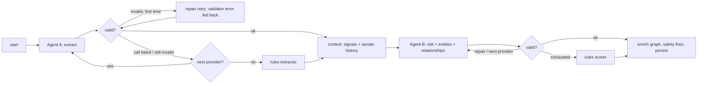

# Mail Risk Intelligence

A first version of a triage tool for a compliance team: emails and documents land in a mailbox, two
chained LLM agents extract **who is involved and what they want**, then assess **risk** and build a
**knowledge graph** of people, organisations, money and accounts across the whole mailbox.

- **Backend:** Python 3.12, FastAPI, LangGraph, SQLAlchemy on SQLite (WAL), separate worker process
- **Frontend:** React 18 + TypeScript, Vite, TanStack Query, zod, CSS Modules + design tokens, react-force-graph-2d
- **LLM:** Groq free tier by default; Gemini free tier or a fully local Ollama model as alternatives;
  a deterministic rules engine when no model is reachable. **No paid key is needed.**

> Track: **full-stack / pipeline**. The design effort went mostly into agent orchestration,
> failure handling, the entity/relationship model and the API.

---

## Quick start

Requires Docker (Compose v2.24+).

```bash
git clone https://github.com/HarrBarr/mail-risk-intel.git
cd mail-risk-intel
cp .env.example .env          # paste a free GROQ_API_KEY from https://console.groq.com/keys
docker compose up --build
```

Open **http://localhost:8080**. The 10 seed emails are loaded on first start and processed by the
worker; the inbox updates live as each one finishes.

| You have | Run | What happens |
|---|---|---|
| A Groq key (free) | `docker compose up --build` | Groq `openai/gpt-oss-120b` for both agents; the seed set takes ~2.5 min on the free tier |
| No key, want a real model | `docker compose --profile local up --build` | Starts Ollama, pulls `OLLAMA_MODEL` (≈5 GB, once); results switch from rules to the LLM as soon as the model is ready |
| Ollama already on your machine | set `OLLAMA_BASE_URL=http://host.docker.internal:11434` and `OLLAMA_MODEL` in `.env` | Uses your local model |
| Nothing | `docker compose up --build` | Rules engine only; the UI shows a banner and tags results `fallback` |

API docs (OpenAPI) are at http://localhost:8000/docs.

### Running without Docker

```bash
cd backend && uv venv --python 3.12 && uv pip install -e ".[dev]"
# uses the repo-root .env (see Quick start); natively set OLLAMA_BASE_URL=http://localhost:11434
.venv/bin/uvicorn app.main:app --reload --port 8000      # terminal 1 (creates the DB and seeds it)
.venv/bin/python -m app.worker                           # terminal 2
cd ../frontend && npm ci && npm run dev                  # terminal 3 -> http://localhost:5173
```

### Tests

```bash
make test           # backend (pytest) + frontend (vitest); no network, no LLM needed
make test-live      # opt-in: runs real seed emails through your configured provider
make lint           # ruff, mypy, eslint, tsc
```

---

## Architecture

```
            ┌────────────┐  POST /api/emails (text | .txt | .pdf | .eml)
 browser ──▶│ web (nginx)│──▶ api (FastAPI) ──▶ ingestion/parsers ──▶ emails(status=pending)
            └────────────┘          ▲                                       │
                 GET /api/...       │ SQLite (WAL, shared volume)           │ claim (atomic UPDATE)
                                    │                                       ▼
                                    └──────────────────────────── worker ── LangGraph pipeline
```

| Layer | Where | Responsibility |
|---|---|---|
| Ingestion | `backend/app/ingestion/` | Seed JSON, pasted text, `.txt`, `.pdf`, `.eml` → one `RawEmail`. Mechanical parsing only; anything missing (e.g. headers in pasted text) is left for Agent A |
| Agents | `backend/app/agents/` | Prompts + Pydantic output contracts for Agent A (`extraction.py`) and Agent B (`risk_graph.py`); deterministic `signals.py`; rules `fallback.py`; entity identity + graph enrichment `entities.py` |
| LLM access | `backend/app/llm/` | Provider factory + fallback chain (`provider.py`); retries, error classification, JSON extraction (`invoke.py`) |
| Orchestration | `backend/app/orchestration/graph.py` | The LangGraph state machine (below) |
| Storage | `backend/app/storage/` | SQLAlchemy models + a repository module; nothing else writes SQL |
| API | `backend/app/api/` | REST endpoints + response models (the contract the UI validates with zod) |
| Worker | `backend/app/worker.py` | Polls for pending emails, runs the pipeline with a concurrency cap |
| UI | `frontend/src/` | Inbox, detail, entities panel, add-email dialog, knowledge graph |

### The pipeline



Design points:

1. **Agent B never reads the raw email**, only Agent A's structured output plus two inputs computed by
   code: deterministic **signals** (lookalike domains, internal→personal mail, keyword categories) and
   **sender history** mined from earlier emails on the same domain. That history is what lets the
   pipeline catch E004: the vendor's new account `…9902` differs from `…6621` on file in E009, and
   the invoice is 3.4× the usual amount. A single-email agent cannot see that.
2. **Every failure has a defined next step.** Transient errors (timeouts, 429, 5xx) retry with
   exponential backoff that honours `Retry-After`. Permanent errors (401, 400) skip the provider at
   once. Invalid JSON or a schema violation gets **one repair retry** with the validator's message
   in the prompt, then the next provider, then rules. Failover is **sticky within a run**: if Groq
   timed out during extraction, assessment goes straight to the next provider.
3. **Safety floor.** If code found a strong signal (spoofed domain, lookalike link, bank-detail
   change, threat language, MNPI, exfiltration, credential phishing) and the LLM still says
   none/low, the level is raised to medium and the rationale says why. The LLM keeps the final say
   above medium.
4. **The pipeline always completes.** Results say who produced them (`provider`, `model`), and each
   step is logged in `processing_steps` (attempts, latency, outcome `ok | repaired | fallback |
   error`, error text). The UI shows this as a processing trace. Unexpected exceptions mark only that
   email `failed`, and it gets a Retry button.

### Data model

```
emails ─┬─ extractions (1:1)          entities (global, deduplicated by (type, canonical_key))
        ├─ risk_assessments (1:1)        ▲            ▲
        ├─ processing_steps (1:n)        │            │
        ├─ entity_mentions (n:m) ────────┘            │
        └─ relationships (source_entity, type, target_entity, confidence, email_id)
```

- **Entities are global.** The same real-world thing gets one row no matter how many emails mention
  it, so the knowledge graph is a plain aggregate (`GET /api/graph`). `canonical_key` handles the
  variants: `$47,300` = `$47,300.00`, `Acct ****6621` = `account ending 6621`,
  `Northgate Suppliers Inc.` = the org behind `northgate-suppliers.com`, and a person is keyed by email
  when one is known.
- **Provenance is kept.** `entity_mentions` and `relationships.email_id` record which email asserted
  what, so reprocessing one email replaces only its own facts.
- **Extensible without migrations.** Entity and relationship `type` are open strings (the prompt
  suggests a vocabulary; the schema normalises it to snake_case), and per-type details live in
  `attributes_json`.
- **Graph backbone.** The links between mailboxes, their organisations and `sent_email_to` edges are
  added deterministically after Agent B, so they don't depend on how a given model run named things.

### API

| Method | Path | Notes |
|---|---|---|
| GET | `/api/health` | `mode: llm \| rules`, the provider chain in order, queue counts by status |
| GET | `/api/emails` | `?risk=&status=&q=&limit=&offset=`; newest first |
| POST | `/api/emails` | JSON `{"raw_text": "..."}` **or** multipart `file` (.txt/.pdf/.eml, ≤5 MB) → `202 {id, status}`; bad input → `422 {detail}`; wrong content type → `415` |
| GET | `/api/emails/{id}` | original content, extraction, risk + signals, entities, relationships, processing trace (latest run) |
| POST | `/api/emails/{id}/reprocess` | `202`; `409` while that email is in flight |
| POST | `/api/emails/reprocess-all` | re-queue everything (e.g. after a prompt change) |
| GET | `/api/graph` | `?min_risk=` to keep only facts from emails at or above a level |

Processing is **asynchronous**: `POST` returns at once and the UI polls. A slow free-tier model never
blocks an HTTP request, and the API stays usable when every LLM is down.

---

## Key decisions and trade-offs

| Decision | Why | Trade-off |
|---|---|---|
| LangGraph for orchestration | The retry/repair/fallback policy is a state machine; writing it as one makes every path explicit and testable with a fake model | A dependency for what could be ~100 lines of loops. I kept the graph small and put the policy in one node factory shared by both agents |
| JSON mode + Pydantic validation, not tool calling | Works the same on Groq, Gemini and small Ollama models; tool calling is flaky on 7–8B models | Needs the repair loop and lenient validators (synonyms, casing) |
| Deterministic signals alongside the LLM | Lookalike domains and account changes are facts that code verifies more reliably than a model does; they also drive the offline fallback | Keyword lists are English-only and brittle. They are evidence fed to the LLM, not the verdict |
| Separate worker process + SQLite WAL | Ingestion stays fast and LLM latency never reaches the HTTP layer; the worker can crash and resume (`recover_in_flight`) | SQLite limits concurrent writers. Fine at this scale; Postgres + a real queue for production |
| Polling, not websockets | Simple and robust; polling stops once nothing is in flight | Up to ~2 s of UI lag |
| CSS Modules + one token file (`frontend/src/styles/tokens.css`) | The UI follows a defined brand (the "Northern lights" dark palette: glass surfaces, Sora/Inter/JetBrains Mono). Encoding it once as CSS custom properties, with scoped per-component modules, keeps every surface on-brand with no runtime cost, no utility-class noise and no extra dependency (Vite handles modules natively). Fonts are self-hosted, so there are no external requests | Canvas colours for the graph have to be mirrored in TS. Tints rely on `color-mix()` (Chrome 111+, Safari 16.2+, Firefox 113+). The first version used Tailwind; see PROCESS.md §3.6 |

**Assumptions.** The organisation's own domain is `arcline.com` (`ORG_DOMAIN`). A standalone PDF
is treated as a document dropped into the mailbox, not an email. Risk "none" means routine mail,
not "verified safe".

**Deviations from the development guide.** I skipped `langgraph-checkpoint-sqlite`: a reprocess
restarts an email from scratch, and the worker re-queues in-flight emails after a crash. Mid-run
resume isn't worth the complexity when one run is two LLM calls.

---

## LLM choice and fallback behaviour

- **Default: Groq free tier, `openai/gpt-oss-120b`** with `reasoning_effort=low`. Calls take about
  1–5 s and need no card. The free tier's real limit is **8,000 tokens per minute**, and one email uses
  about 4–5k tokens across both agents. So the pipeline expects 429s: it waits for the time Groq
  asks for (`Retry-After`, up to 60 s, `LLM_MAX_RETRIES=4`), and the worker's concurrency defaults
  to 2. "Request too large" 429s are not retried, since they can never succeed. When Groq's
  server-side JSON check rejects an output (`400 json_validate_failed`), the rejected text goes to
  the normal repair retry instead of counting as an outage.
- **Groq retires models often.** If `GROQ_MODEL` is no longer offered, calls fail with
  `model_not_found` and results quietly come from the next provider or from rules (visible as the
  `fallback` chip). List the current models at https://console.groq.com/docs/models.
- **Gemini free tier** works the same way: set `GEMINI_API_KEY`.
- **Ollama** is fully offline. Any model works; tested with `qwen2.5:7b`.
- **Rules** are always last in `LLM_FALLBACK_CHAIN` (default `groq,gemini,ollama,rules`). Providers
  that aren't configured, such as one without a key or an Ollama that is unreachable or hasn't
  pulled the model, are skipped up front instead of failing per call. The worker re-checks every
  60 s, so a model that finishes downloading is picked up without a restart.
- In development, `APP_ENV=development` with `DEV_LLM_PROVIDER/DEV_LLM_MODEL` points the pipeline at
  another model (including paid ones, installed only with the `dev` extra) without changing the
  reviewer-facing default.

**If the API is unavailable when you run this,** the app still starts. `/api/health` reports
`mode: rules`, the UI shows a banner, and every email is processed by the rules engine, which scores
the seed set as follows: E001/E003/E004/E005/E006/E008 high, E010 medium, E002/E007/E009 none. Those
results are labelled `fallback`. When a model becomes reachable, use **Retry** on an email (or
`make reprocess`) to upgrade it.

### Results with a real model

**Groq (the default), full seed set, free tier, worker at concurrency 2: 157 s for all 10 emails.**
Every email was processed by Groq; none fell back to rules. One assessment needed the repair retry,
and rate-limit waits were absorbed by retries.

| Email | Expected | Groq `gpt-oss-120b` | Tags |
|---|---|---|---|
| E001 CEO impersonation | high | **high** | spoofed-domain, urgency, payment-change, financial-anomaly |
| E002 IT notice | none | none | |
| E003 data to personal address | high | **high** | data-exfiltration, secrecy, internal-to-personal |
| E004 vendor bank change | high | **high** | payment-change, financial-anomaly, bank-detail-change |
| E005 insider tip | high | **high** | mnpi-risk, secrecy, internal-to-personal |
| E006 threat | high | **high** | threat-language |
| E007 HR calendar | none | none | |
| E008 phishing | high | **high** | spoofed-domain, credential-phishing, urgency, suspicious-link |
| E009 normal invoice | none/low | none | |
| E010 whistleblower | medium | medium | accounting-irregularity, whistleblower-report |

E004's rationale shows the cross-email reasoning working: *"requests payment to a new bank account
ending 9902, which differs from the known account ending 6621, and the invoice amount $47,300 is 3.4x
the prior median"*. In the graph, Northgate, `routing 044000037` and `account ending 6621` are each
a single node shared by E004 and E009.

**Local Ollama.** I tuned the prompts against the *weakest* model a reviewer might plausibly use:
`qwen2.5:7b` running on CPU. These are the cases that need judgment:

| Email | Level | Rationale (abridged, verbatim from the model) |
|---|---|---|
| E001 (CEO impersonation) | **high** | "sent by a domain that imitates 'arcline.com' and requests an urgent, large wire transfer… asks not to loop in others" |
| E004 (vendor bank change) | **high** | "new bank account (account ending 9902), which differs from the prior known account (6621) in E009… significantly higher than the previous median invoice amount ($13,900)" |
| E009 (normal invoice) | low | "routine invoice request with standard payment terms" |
| E002 (IT notice) | none | "routine IT communication about scheduled maintenance" |

All four produced valid JSON on the first attempt, with no repair retry needed. The first prompt
version had rated E001 only *medium* and merged account numbers; `PROCESS.md` §3.1 has the
before/after. On CPU a 7B model takes 2–10 minutes per email, which is why Groq is the default.

---

## What I'd do with more time

- **Evaluation harness.** A labelled set (the seed emails plus adversarial variants), a scored
  run per prompt or model change, tracked over time. Right now prompt quality is checked by hand and by
  `pytest -m live` on the clear-cut cases.
- **Entity resolution beyond keys.** Link "James" (signature) to `j.harrington-ceo@…` and to the
  real CEO entity, and flag the *impersonation* edge explicitly; fuzzy-match organisation names.
- **Graph-level risk.** Patterns visible only across emails, such as a vendor with two accounts or a
  person mailing several personal addresses, surfaced as their own alerts.
- **Production shape.** Postgres, a real queue (or Postgres `SKIP LOCKED`), per-provider circuit
  breakers shared across workers, auth and audit log, PII handling, attachment malware scanning, OCR
  for scanned PDFs.
- **UI.** Triage workflow (assign, resolve, notes), saved filters, graph search and time slider.

## Time spent

About **4 hours of hands-on time**: planning, drafting the development guide, decisions, review and
testing. The AI-assisted build session itself ran about 6¾ hours of wall-clock time, much of it
unattended agent work and slow local-model evaluation. `PROCESS.md` has the breakdown.
